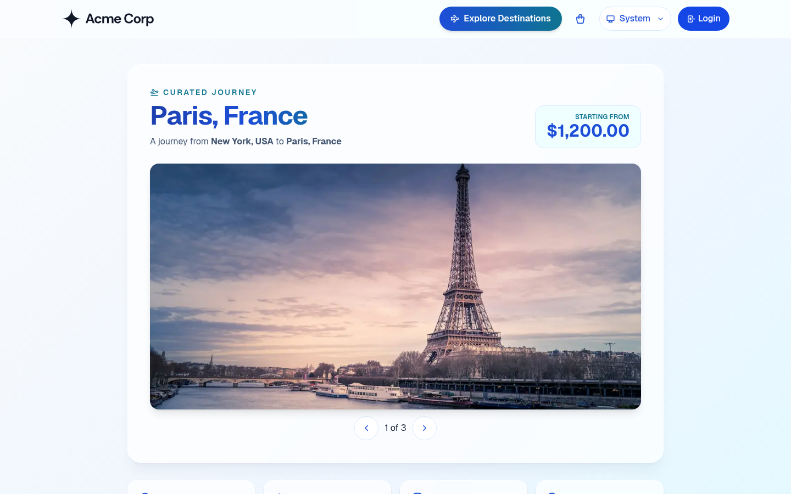
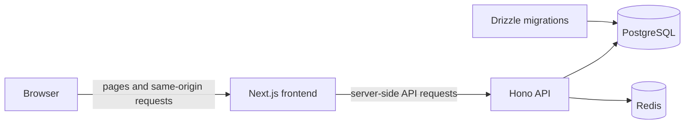

# ACME Travel

ACME Travel is a full-stack travel booking application. Travelers can explore trips, manage a cart, make a simulated booking, and review booked journeys. Agents can publish trips and manage itineraries.

## Application




Screenshots use sample data from an isolated development database.

## Features

- Browse server-rendered destinations, trip details, itineraries, and reviews.
- Create a customer or agent account, sign in, and manage a profile.
- Add trips to a cart, confirm a simulated payment, view bookings, and cancel a booking.
- Publish trips and itineraries as an agent. Customers with confirmed bookings can leave reviews.
- Choose a light, dark, or system theme, with responsive navigation and keyboard-accessible controls.

Checkout is a simulation and does not charge a payment method.

## Architecture



The frontend renders public trip pages on the server and proxies browser API requests through Next.js. The backend handles authentication, trip and booking operations, and validation. PostgreSQL stores application data, and Redis supports rate limiting and caching. Session credentials are held in HttpOnly cookies.

| Component | Technology | Default address |
| --- | --- | --- |
| Frontend | Next.js 15, React, Tailwind CSS | http://localhost:3001 |
| API | Hono, TypeScript, Drizzle ORM | http://localhost:3000 |
| Data services | PostgreSQL, Redis | Compose private network |

## Start with Docker Compose

Install Docker with the Compose plugin, then create the root environment file.

```sh
cp .env.example .env
```

Edit `.env` and set a URL-safe PostgreSQL password in both `POSTGRES_PASSWORD` and `DATABASE_URL`. Set `JWT_SECRET` and `JWT_REFRESH_SECRET` to distinct random values of at least 32 characters. Keep the database hostname in `DATABASE_URL` as `postgres` for Compose.

```sh
docker compose up --build
```

Compose starts PostgreSQL and Redis, applies the database migrations, and starts the API and frontend. Open http://localhost:3001. The API documentation is at http://localhost:3000/docs, its OpenAPI document is at http://localhost:3000/openapi, and its readiness endpoint is at http://localhost:3000/health/ready.

A fresh database has an empty catalog. Sample data can be loaded into a **disposable development database** using the seed command described below. Seeding clears the application tables.

## Local development

Use Node.js 22 and pnpm 12.18.0. Run commands from each package directory. PostgreSQL and Redis must be running and accessible to the backend.

1. Copy `acme_backend/.env.example` to `acme_backend/.env.local`. Set `DATABASE_URL`, `REDIS_URL`, distinct JWT secrets, and the frontend origin in `ALLOWED_ORIGIN`.
2. Install dependencies, migrate the database, and start the API.

   ```sh
   cd acme_backend
   pnpm install --frozen-lockfile
   pnpm db:migrate
   pnpm dev
   ```

3. In a second terminal, copy `acme_frontend/.env.example` to `acme_frontend/.env.local`. Set `API_URL` to the API origin and `APP_ORIGIN` to the frontend origin, then start the frontend.

   ```sh
   cd acme_frontend
   pnpm install --frozen-lockfile
   pnpm dev
   ```

For sample records, set the backend's `DATABASE_URL` to a disposable database and run `ACME_DEMO_SEED=1 pnpm seed` from `acme_backend/`. The seed truncates application tables and refuses production mode.

The root `.env` configures Compose. The package `.env.local` files configure processes started directly on the host.

## Checks

From `acme_frontend/` run `pnpm lint`, `pnpm test`, and `pnpm build`. From `acme_backend/` run `pnpm typecheck`, `pnpm test`, and `pnpm build`. Backend tests require a migrated and seeded disposable database.

For full-stack browser checks, build both packages, prepare an isolated migrated and seeded backend, install browsers with `pnpm exec playwright install chromium firefox` in the frontend, then run `pnpm test:e2e`. The backend's `pnpm test:upgrade` also requires a separate empty database in `UPGRADE_DATABASE_URL`.

## Project layout

- `acme_frontend/` — Next.js routes, UI, API proxy, and browser tests.
- `acme_backend/` — Hono API, database schema and migrations, and integration tests.
- `docker-compose.yml` — local full-stack services and migration job.
- `docs/deployment.md` — deployment, existing database upgrades, and API behavior.

Read the [deployment and upgrade notes](docs/deployment.md) before upgrading an existing database or deploying the application.
